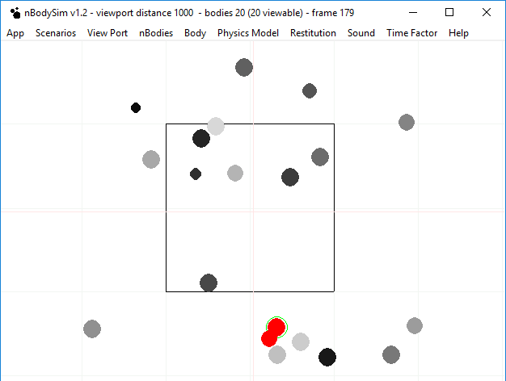

# nBodySim

An N-body simulation of spheres interacting through Newtonian gravitation, with
collision responses.



The original program was written by Lewis Sellers (aka Min) in C++ using
MSVC++ 6 Professional SP5 and the Microsoft Platform SDK. It began as a port of
software for the TI-85/86 graphing calculator.

Intrafoundation Software
<http://www.intrafoundation.com/products/nBodySim>

There is very little documentation for the original physics implementation.
Maybe someday the collision functions will be completed and the mathematics
properly documented.

## C# desktop port

A Windows Forms port targeting .NET 10 is available in
[`nBodySim.CSharp`](./nBodySim.CSharp/). Open
[`nBodySim.CSharp.csproj`](./nBodySim.CSharp/nBodySim.CSharp.csproj) in Visual
Studio, or build and run it from a Windows terminal:

```powershell
dotnet build .\nBodySim.CSharp\nBodySim.CSharp.csproj
dotnet run --project .\nBodySim.CSharp\nBodySim.CSharp.csproj
```

The port includes the simulation controls, scenarios, viewport controls, body
selection, mouse-driven momentum input, and the original Sarah artwork in its
About dialog. The original C++ sources and legacy WinHelp files remain in the
repository.

## Original notes

If you are a physics major or graduate and understand the mathematics behind
rigid-body collisions, feel free to get in touch. It would be great to make
this a complete, well-documented, functional software package for high-school
and college demonstrations.

The original plan was to eventually support elastic collisions of more complex
objects (such as liquids) with friction.

Thanks,

Lewis Sellers

--min

## Version history

### v1.3 — February 2017

Refreshed for Visual Studio 2015 and GitHub.

### v1.2 — October 31, 2004

- Added the help file and recompiled.
- Collision functions were not working correctly. Catastrophic
  interpenetration could send objects too deeply into one another and produce
  very high false acceleration in the opposite direction. Fractional or
  partial-time computations were identified as a possible solution. Smaller
  time steps reduced the problem, at the cost of slower interactions.
- Added new graphics for the About dialog, inspired by the author's prickly
  cat, Sarah, who bites a lot.
- Added collision sound effects.
- Planned scenario load/save support for storing n-body scenarios, the current
  view, and body position and momentum data in text files.

### v1.1 — April 2003

Undocumented. A major rewrite improved collisions, though they still did not
work correctly.

### v1.0 — Early 2003

Undocumented.

### v0 — Early 2003

Undocumented. The original program was written in C++ using MSVC++ 6
Professional SP5 and the Microsoft Platform SDK.
